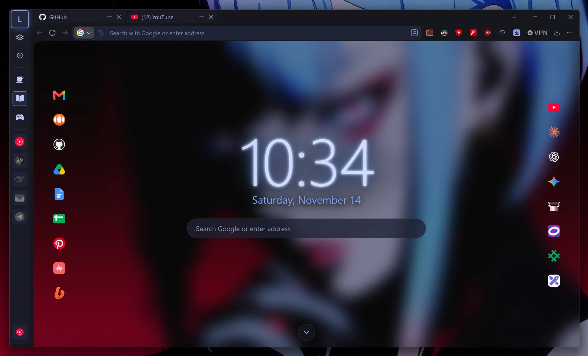
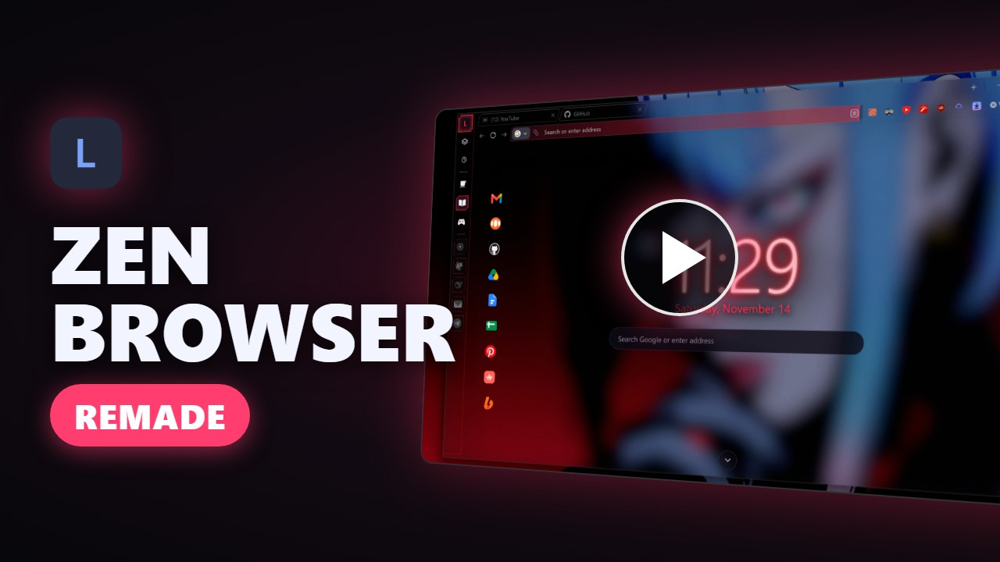
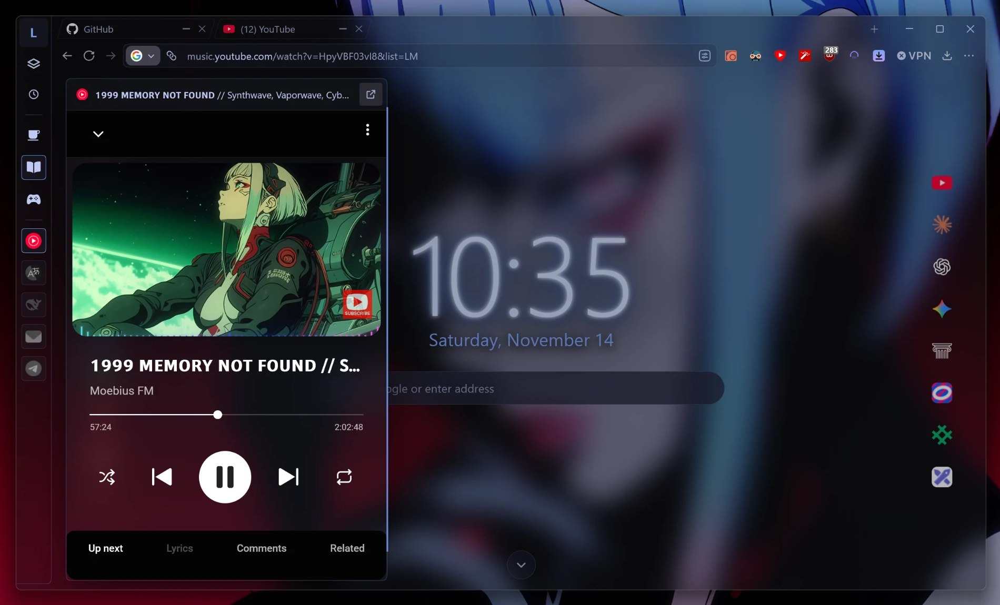
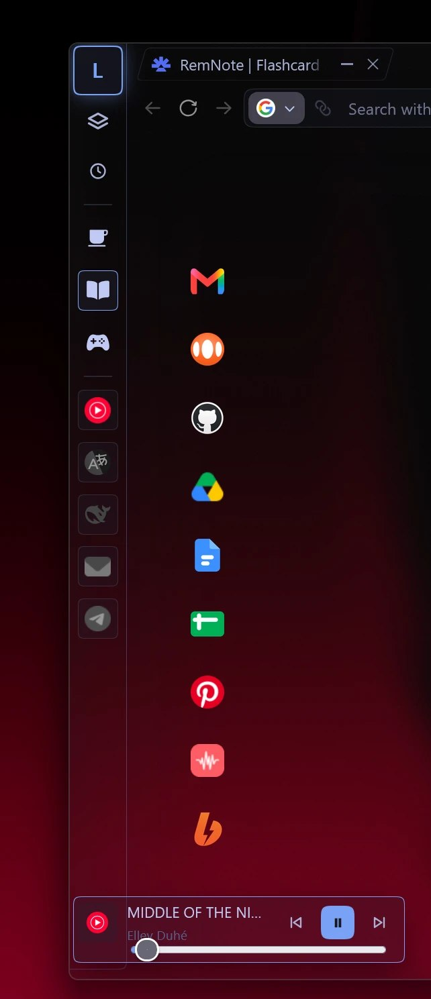
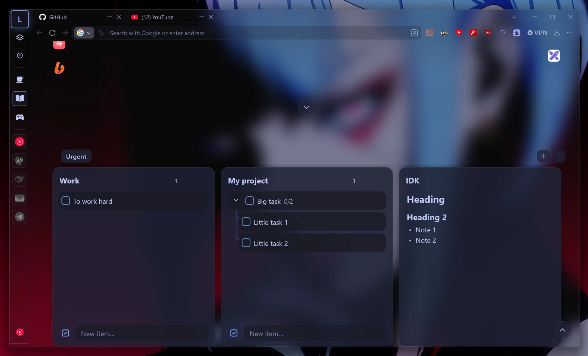
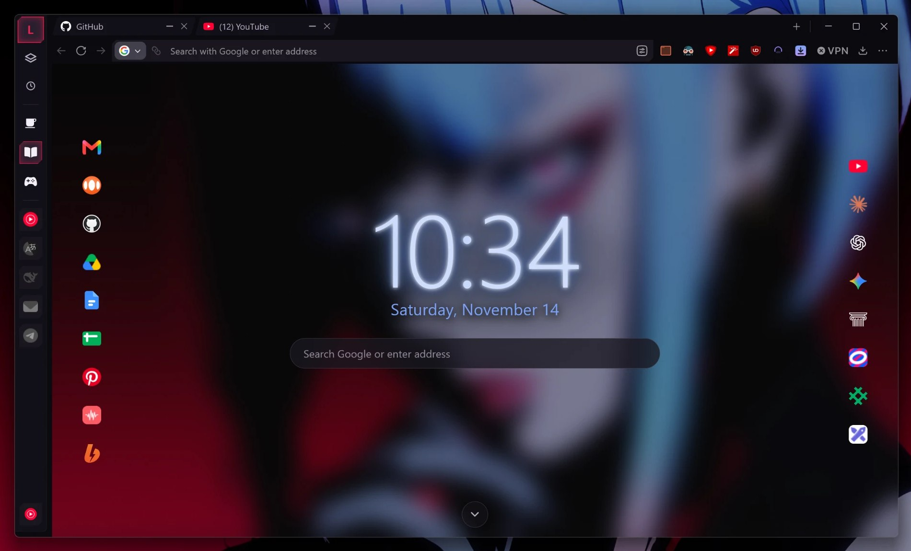
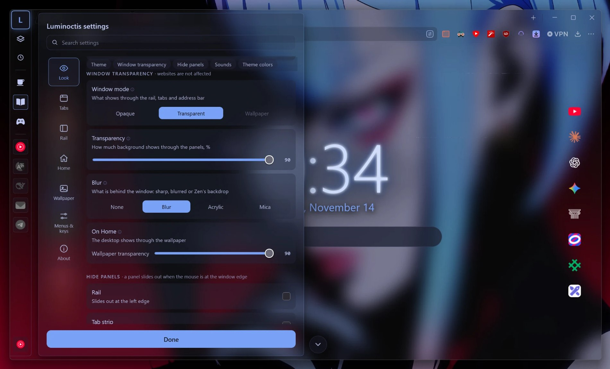

# Luminoctis

**A full makeover mod for [Zen Browser](https://zen-browser.app/) on Windows** — a tab strip on top, a slim side rail, a Home page with clock, notes and wallpapers, glass window modes, 9 colour palettes and interface sounds.

by Laith · [MPL-2.0](LICENSE)

**▶ [Watch the 1-minute overview on YouTube](https://youtu.be/FFGqXpoK90U)**

## Download

**[⬇ Latest release](https://github.com/Luminoctis/Luminoctis/releases/latest)** — download `Luminoctis-Setup-<version>.exe` and run it.

1. Close Zen Browser.
2. Run the installer and pick your Zen profile. It does everything in one click: installs the script loader ([fx-autoconfig](https://github.com/MrOtherGuy/fx-autoconfig), asks for administrator rights once), copies the mod into the profile and sets the Zen options the mod needs.
3. Start Zen. To open the mod's settings, right-click an empty spot on the side rail → **Luminoctis mod settings**.

Windows may show *“Windows protected your PC”* — click **More info → Run anyway** (the installer is not code-signed).

- **Update:** run the installer of the new version. Your previous files are backed up first.
- **Uninstall:** run the installer and click **Uninstall**.

**Requirements:** Windows 10 or 11 (glass modes need Windows 11), Zen Browser.
The interface is available in English, 中文, Español, العربية, Português, Bahasa Indonesia, Français, 日本語, Русский and Deutsch — it follows Zen's language.

## What it does

**Tabs on top**
- One tab strip at the top edge of the window; tabs shrink to fit, down to icon squares, so they never hide.
- Drag to reorder, drop outside to open a new window, drop on the rail to pin.
- Unloaded tabs are greyed out; an optional timer unloads tabs you have not used for a while.
- Hover a tab for a card with its title and memory use.

**Side rail**
- Workspaces, pins (Zen Essentials, shared across workspaces) and media players in a 48 px rail.
- Clicking a pin opens the site in a mini-window next to the rail, over the current page.
- Media tiles: hover for title and controls, click the icon to play/pause.

**Luminoctis Home**
- Press **L** on the rail: clock, search, shortcuts, notes (Markdown), LumiTime timer and wallpapers.
- Scroll down on Home for note boards: checklists with sub-tasks and Markdown notes.

**Look**
- Window modes: Opaque, Transparent (desktop shows through with blur) and Wallpaper.
- 9 palettes — Tokyo Night, Tokyo Night Storm, Catppuccin Mocha, Dracula, Nord, Gruvbox Dark, Rosé Pine, One Dark and GX (neon accent, cut corners) — every colour editable.
- Rounded, square or slanted tabs; Compacting hides the rail, tab strip or address bar until the mouse reaches the edge.
- If Windows colour settings break transparency, the mod tells you and fixes them with one click.

**Also**
- Interface sounds (optional).
- Configurable shortcuts.
- Hide items in the ⋯ and tab menus.
- A tab opened only to download a file closes itself, like in Chrome.

All settings are in one panel: right-click an empty spot on the side rail → **Luminoctis mod settings**. Changes apply instantly.

## Without the installer

The Zen Mods store version (CSS only, look without scripts) is planned as **Luminoctis Lite**.
To install by hand from source: close Zen and run `install.cmd` from this repository (`install.cmd -Uninstall` removes the mod).

## License and name

The code is under the [Mozilla Public License 2.0](LICENSE). `vendor/fx-autoconfig` is third-party code under its own license (MPL-2.0). Sounds and their licenses are listed in [sounds/LICENSE.txt](sounds/LICENSE.txt).

**Luminoctis™** and its logo are trademarks of Laith and are not licensed under the MPL (section 2.3). Forks and derived projects must use a different name and logo and must not present themselves as Luminoctis — see [TRADEMARKS.md](TRADEMARKS.md).
